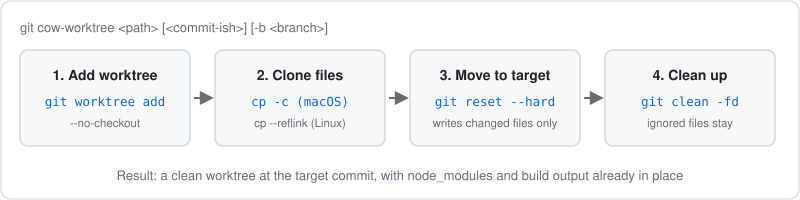

# git cow-worktree

Make a new git worktree as a copy-on-write clone of the one you work in.
The new worktree shares disk blocks with the original. It also gets your ignored files
(`node_modules`, build output, caches) with no reinstall.



## Why

`git worktree add` writes every tracked file again. Ignored files do not come across, so you
run `npm install` (or the equivalent) in each new worktree. In a large monorepo this is slow,
and each worktree uses the full size again on disk.

APFS (macOS), Btrfs and XFS can clone a file. A clone shares the disk blocks of the original
until one of the two copies changes. This tool uses that clone for the worktree.

| | `git worktree add` | `git cow-worktree` |
|---|---|---|
| Tracked files | written again | cloned, only changed files written |
| Ignored files (`node_modules`, `dist`) | missing | cloned |
| New disk space | full size of the checkout | near zero until you edit |

## How it works



1. `git worktree add --no-checkout <path> ...` makes the worktree and writes no files.
2. Each top-level entry of the current worktree (except `.git`) is cloned into it:
   `cp -c` on macOS, `cp --reflink=always` on Linux.
3. `git reset` loads the index from the target commit. `git reset --hard` then writes only
   the files that differ from that commit.
4. `git clean -fd` removes untracked files that came from the source. Ignored files stay.

The result is a clean worktree at the commit you ask for. Your source worktree does not change.

## Requirements

- git 2.17 or later.
- bash.
- The source and the new worktree on the same volume, and that volume supports clones:
  APFS on macOS, or Btrfs or XFS (with reflink) on Linux. ext4 does not support clones.
  On a volume without clone support the tool stops with an error. Remove the part-made
  worktree with `git worktree remove --force <path>`.

## Setup

1. Put the script in a folder on your `PATH`. Git runs any `git-<name>` file on `PATH` as
   `git <name>`, so you do not need an alias.

   ```sh
   mkdir -p ~/bin
   curl -fsSL https://raw.githubusercontent.com/RO-29/git-cow-worktree/main/git-cow-worktree -o ~/bin/git-cow-worktree
   chmod +x ~/bin/git-cow-worktree
   ```

   Read the script before you run it. It is about 60 lines.

2. If `~/bin` is not on your `PATH`, add this line to `~/.zshrc` or `~/.bashrc`:

   ```sh
   export PATH="$HOME/bin:$PATH"
   ```

3. Check that git finds it:

   ```sh
   git cow-worktree
   # usage: git cow-worktree <path> [<commit-ish>] [-b <new-branch>] ...
   ```

## Usage

Run it from inside the worktree you want to clone. The arguments are the same as for
`git worktree add`, with the path first.

```sh
git cow-worktree ../app-feature -b feature/login       # new branch from HEAD
git cow-worktree ../app-hotfix origin/main             # detached at origin/main
git cow-worktree ../app-review some-branch             # existing branch
```

Remove it the usual way:

```sh
git worktree remove ../app-feature
```

## How to check that it works

### Run the test

The test makes a throwaway repository in a temp folder, with a 200 MB ignored folder.
It checks the branch, the file content at the target commit, the ignored folder, a clean
`git status`, an unchanged source, and that the clone used less than 100 MB of new space.

```sh
git clone https://github.com/RO-29/git-cow-worktree.git
cd git-cow-worktree
bash test/test.sh
```

Expected output:

```
clone time: 0 s, new disk space: 1 MB for a 200 MB ignored folder
PASS: all checks
```

### Check your own repository

Compare free space before and after. Use `df`, not `du`: `du` counts each clone at full
size, so it shows no saving.

```sh
df -h .
time git worktree add ../wt-plain -b wt-plain-test
df -h .
time git cow-worktree ../wt-cow -b wt-cow-test
df -h .
```

Then remove both test worktrees and branches:

```sh
git worktree remove --force ../wt-plain && git branch -D wt-plain-test
git worktree remove --force ../wt-cow && git branch -D wt-cow-test
```

## Limits

- Submodules are not set up. The tool prints a warning; run `git submodule update --init`.
- Some tools store absolute paths, for example Python virtual environments and some build
  caches. The clone of such a folder still points at the source worktree. Rebuild it in the
  new worktree.
- Ignored files come from the source worktree as they are now. If the target commit needs
  different dependencies, run your install command again.
- A worktree folder that is inside the source tree is not copied (the tool prints `skip`).

## License

MIT
